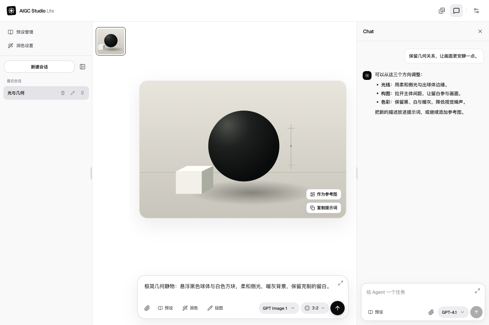

<p align="center">
  
</p>

<h1 align="center">AIGC Studio Lite</h1>

<p align="center">
  <strong>从一句描述，到一张图，再到下一次迭代。</strong><br>
  本地优先的轻量 AI 图像工作台，把生图、Agent 对话、参考图和提示词放进同一个会话。
</p>

<p align="center">
  <a href="https://github.com/MikuHello/aigc-studio-lite/actions/workflows/ci.yml"></a>
  · 自带 API Key · 浏览器本地保存 · Cloudflare Workers
</p>

<p align="center">
  <a href="https://aigc-studio-lite.level5.workers.dev/">在线使用 ↗</a> ·
  <a href="#快速开始">快速开始</a> ·
  <a href="#模型与连接">模型与连接</a> ·
  <a href="#自动部署">自动部署</a> ·
  <a href="#开发">开发</a>
</p>



<p align="center"><sub>界面演示参考</sub></p>

## 创作，不必来回切换

- **直接生图，或交给 Agent。** 在工作台调整提示词和生成参数，也可以通过支持工具调用的文本模型完成生图任务。
- **围绕参考图继续迭代。** 上传、标注、复用图像；润色提示词、对比后采用，把常用描述保存为预设。
- **让每次探索有迹可循。** 会话独立保存生图与 Chat 草稿，图库支持搜索、筛选、下载和批量管理；窄屏也能使用。

## 快速开始

直接打开 **[在线工作台](https://aigc-studio-lite.level5.workers.dev/)**，在设置中接入自己的模型即可使用。

如需本地运行，准备 **Node.js 24**，版本约定见 [`.nvmrc`](.nvmrc)。

```bash
git clone https://github.com/MikuHello/aigc-studio-lite.git
cd aigc-studio-lite
npm ci
npm run dev
```

打开终端显示的本地地址，默认是 `http://127.0.0.1:5173`：

1. 进入 **设置**，填写服务商 API 地址与 Key，获取模型；也可手动填写模型 ID 和能力。
2. 选择图像模型，输入画面描述；需要时添加参考图。
3. 点击 **生成**。需要 Agent 协助时，再选择支持工具调用的文本模型。

项目不提供模型额度；实际调用使用所配置服务商的 API 与计费规则。

## 模型与连接

设置页支持 **OpenAI / 兼容服务、Google Gemini、xAI**。OpenAI 兼容文本接口可自动选择 Chat Completions / Responses；图像参数随模型能力显示。

| 网络方式    | 适用场景                                                    |
| ----------- | ----------------------------------------------------------- |
| 自动        | 有同源 Worker 代理时使用代理，否则直连                      |
| 直连        | 浏览器直接请求 API；自定义网关使用此方式，需支持 CORS       |
| Worker 代理 | 同源 `/api/proxy` 转发，仅放行代码白名单中的官方 HTTPS 主机 |

Anthropic 适配器保留在代码层，设置页暂未提供新增入口。模型 ID 推断和手动能力声明不能替代服务商的实际支持范围。

## 自动部署

一套 [GitHub Actions 工作流](.github/workflows/ci.yml) 完成校验、构建与 Workers 部署。前端静态资源和 `/api/proxy` 随同一个 Worker 发布，无需额外配置业务后端。

1. 在 Cloudflare 创建部署用 API Token，使用 **Edit Cloudflare Workers** 模板并限定到目标账号。
2. 在仓库 **Settings → Secrets and variables → Actions** 添加以下 Secrets：

   | Secret                  | 内容                    |
   | ----------------------- | ----------------------- |
   | `CLOUDFLARE_API_TOKEN`  | Cloudflare 部署令牌     |
   | `CLOUDFLARE_ACCOUNT_ID` | 目标 Cloudflare 账号 ID |

3. 将工作流推送到 `main` 后，校验通过即会自动部署；也可在 **Actions → CI → Run workflow** 选择 `main` 手动运行。

Pull Request 只执行校验与构建。未设置部署 Secrets 时，部署步骤会跳过，并在运行摘要中说明；通过 CI 不等于已部署。流程复用当次构建结果，调用锁定依赖中的 Wrangler，不重复构建。

现有站点：[aigc-studio-lite.level5.workers.dev](https://aigc-studio-lite.level5.workers.dev/)。Worker 名称为 `aigc-studio-lite`，配置见 [`wrangler.jsonc`](wrangler.jsonc)。使用同一账号 ID 和 Worker 名称即可更新已有站点；GitHub 自动部署通过上述 Secrets 认证。

<details>
<summary>本地预览 Worker 或手动发布</summary>

```bash
npm run dev:worker
```

手动发布时，先运行 `npx wrangler login` 完成认证，再执行 `npm run deploy`。不要将部署 Token 写入源码或前端环境变量。

</details>

## 数据留在当前浏览器

作品、会话、预设与设置保存于 IndexedDB，草稿额外写入 localStorage。当前设置页将 API Key 保存在本机 localStorage；Worker 只随请求转发，不持久化 Key。

项目不提供账号、跨设备同步或完整备份导出。清理站点数据会删除本地内容，更换部署域名也不会自动迁移数据。删除会话保留图库图像；删除图像会同时移除相关消息与参考图引用。

## 开发

React + TypeScript + Vite，Zustand 管理状态，Cloudflare Workers 承载同源代理与静态资源。

```bash
npm run check
```

统一执行 lint、格式校验、测试、前端与 Worker 类型检查，以及生产构建。日常使用 `npm run format` 对齐格式，`npm test` 运行风险回归；提交信息采用 **Conventional Commits + gitmoji**。

[开发规范](CONTRIBUTING.md) · [维护记录与部署边界](docs/maintenance.md)
