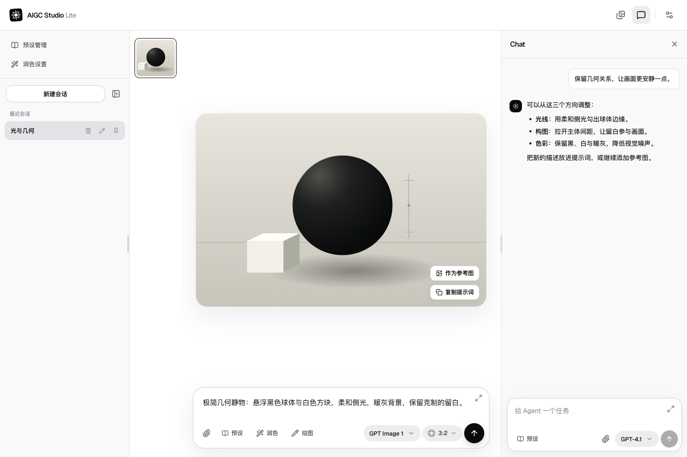

# AIGC Studio Lite


本地优先的 AI 图片与视频工作台，支持参考素材、提示词预设和 Agent 对话。自带 API Key，调用费用由所配置的服务商收取。

[在线使用](https://aigc-studio-lite.level5.workers.dev/) · [开发规范](CONTRIBUTING.md) · [架构](docs/architecture.md) · [模型维护](docs/models.md) · [部署](docs/deployment.md)



## 快速开始

使用 [`.nvmrc`](.nvmrc) 指定的 Node.js 版本：

```bash
git clone https://github.com/MikuHello/aigc-studio-lite.git
cd aigc-studio-lite
npm ci
npm run dev
```

打开终端显示的地址：

1. 在「设置 → 供应商」填写 API 地址与 Key，获取并启用模型；也可手动添加。
2. 在「创作模型」选择图片或视频模型，填写提示词，按需添加参考素材。
3. 调整参数后生成；需要 Agent 协助时，再选择支持工具调用的文本模型。

设置页支持 OpenAI 兼容、Google Gemini、xAI 和火山方舟。默认浏览器直连；遇到跨域限制时，可在该供应商的「编辑连接」中开启「Worker 代理」。自定义网关需先配置[代理允许目标](docs/deployment.md#代理允许目标)，协议边界见[模型维护](docs/models.md#接入边界)。

## 素材与保存

图片与视频共用会话和作品库，分别保存创作草稿。视频参考使用公网链接、已有素材 ID 或作品库；当前不托管本地视频文件。

作品、会话、预设与设置保存在当前浏览器。项目不提供账号同步或完整备份导出；清理站点数据会丢失本地内容，更换域名不会自动迁移。

视频作品保存的是上游链接，链接可能过期，请及时下载。关闭浏览器不会取消上游任务，重新打开后可恢复查询。
